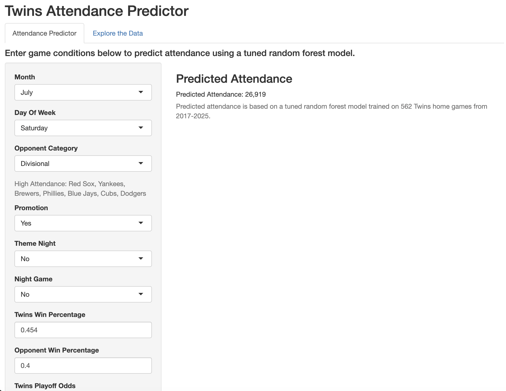
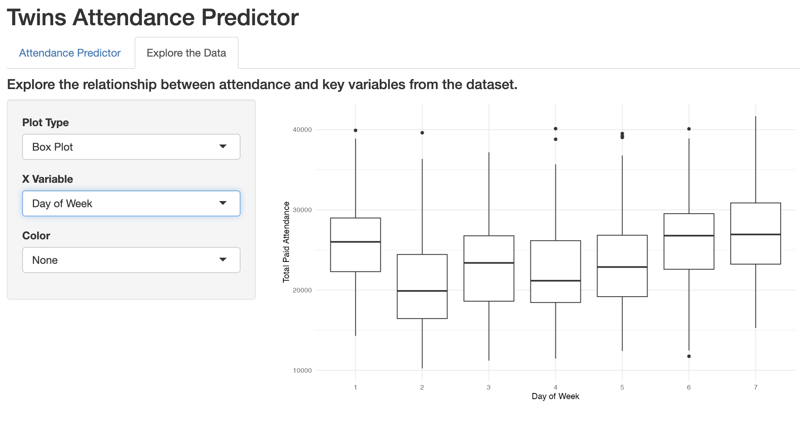
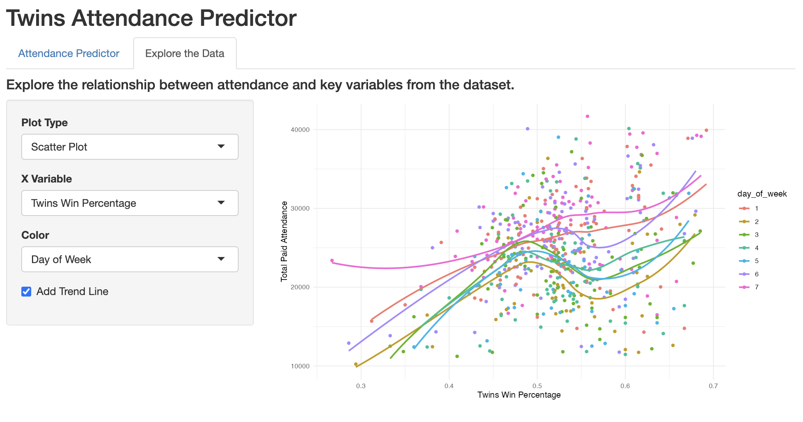

# Minnesota Twins Home Game Attendance Model

An analysis of what drives paid attendance at Twins home games, built in R as part of my MBA with a concentration in business analytics at Augsburg University. The central question is how much team performance affects attendance compared with promotions, scheduling, and weather. The project covers 562 home games from 2017 to 2019 and 2022 to 2025 and ends with a random forest model and an interactive Shiny app for predicting attendance.

The data came from the Minnesota Twins organization and is confidential, so it is not included in this repository.

## Repository Contents

- `01_data_cleaning.qmd`: reads the three source datasets, fixes time zones, handles doubleheaders, joins everything into one game-level dataset, and saves it.
- `02_eda.qmd`: exploratory analysis and visualizations, plus a closer look at how postseason odds and team performance relate to attendance by month and by early versus late season.
- `03_modeling.qmd`: builds and compares four models using 10-fold cross validation.
- `app.R`: a two-tab Shiny app. One tab predicts attendance from game conditions, and the other lets users explore the data with selectable plots.
- `images/`: screenshots of the Shiny app.

## Shiny App

The Attendance Predictor tab takes game conditions such as month, day of week, opponent category, promotions, and team performance, and returns a predicted attendance from the tuned random forest.

The Explore the Data tab lets users choose a plot type, an x variable, and an optional color variable.

## Data (Not Included)

Three datasets were used. Only column names are listed here.

**Game attendance and promotions:** DATETIME, OPPONENT, GA PROMO, THEME EVENT, TOTAL PAID ATTENDANCE.

**Game temperature:** Season_ID, Season_Int, Event_Code, Event_Datetime, Event_Date, Event_Time, Temperature_F, DewPoint_F, Humidity. Eight games were missing from this dataset, and their temperatures were added by hand from public box scores.

**Daily team performance for all 30 teams:** date, team, year, wins, losses, dlgb (games back), runs_scored, runs_allowed, and four postseason odds columns (podds, podds_ds, podds_div, podds_wc). The postseason odds come from a third-party simulation model similar to FanGraphs playoff odds.

Without these files the code cannot be run as written. The Quarto files expect the three source files in the working directory, and `app.R` expects `attendance_model_data.rds` and `rf_model.rds`, which are created by the cleaning and modeling files.

## Methods

Cleaning involved converting time zones, splitting date and time, joining temperature on both date and start time so doubleheaders matched correctly, and joining team performance twice, once for the Twins and once for each game's opponent. Features created include night game, month, day of week, a three-tier opponent category, promotion and theme night flags, and win percentage for both teams.

Four models were compared with 10-fold cross validation: linear regression, log-linear regression, a decision tree, and a random forest tuned with `tuneRF`. Variables were selected by starting with a full model and removing those that were not significant or that overlapped heavily with others. For example, temperature was dropped in favor of month because the two are correlated at about 0.50 and the model with month explained more variance.

## Key Findings

The random forest performed best, with a cross-validated RMSE of about 4,400 fans per game and about 55 percent of variance explained. Month, day of week, promotions, and team performance were the most important drivers. Postseason odds mattered more later in the season, and in the late season win percentage became the stronger signal. Games where the Twins were in playoff contention in July through September averaged roughly 17 percent higher attendance than games where they were eliminated.

## Limitations

Only three of the seven seasons had real playoff contention, promotion data was not tracked in a standardized way, and opponent effects were grouped into three categories because some teams appear only a few times. The model also cannot capture fan sentiment about organizational decisions.

## Author

Katie Manecke, Baseball Technology Fellow, Minnesota Twins (2026). MBA with a concentration in Business Analytics, Augsburg University.
